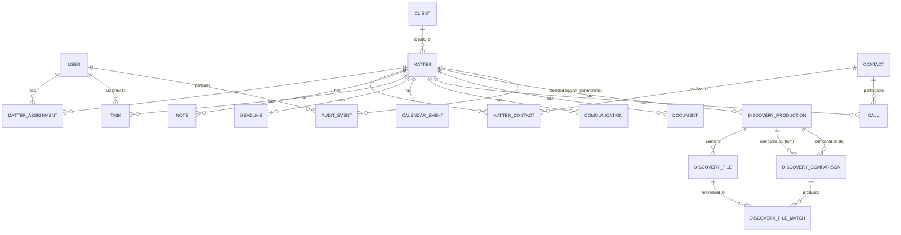

# Data Model

This describes the core entities for v1 planning. This is a design document,
not the implementation — the actual source of truth once built will be
`prisma/schema.prisma`. Field lists below are representative, not exhaustive;
expect refinement once real screens are built.

Much of this document is now implemented — `prisma/schema.prisma` is the
source of truth, and sections marked "real as of …" describe what exists.

## Entity overview

- **User** — firm staff (attorneys, paralegals, admins) who log into the
  system. Not to be confused with Client.
- **Client** — a person or entity the firm represents.
- **Contact** — the permanent firm-wide directory of people and
  organizations (clients' own entries, judges, prosecutors, officers,
  witnesses, family, experts, vendors…). Real as of the Contacts milestone;
  see the `Contact` section below.
- **Matter** — a single case/engagement for a client.
- **MatterAssignment** — join table: which Users are assigned to a Matter,
  and in what role (lead attorney, associate attorney, paralegal, etc.).
- **MatterContact** — join table: which Contacts are involved in a Matter,
  and in what role (soft-removable, so history survives).
- **ContactRelationship** — "A is <type> of B" between two Contacts,
  permanent or matter-specific.
- **ContactInteraction** — a manually recorded interaction with a Contact
  (meeting, email, court appearance, …); logged `Call`s link via
  `Call.contactId` instead.
- **Note** — free-text note attached to a Matter.
- **Task** — actionable to-do attached to a Matter, assignable to a User.
- **Deadline** — a date-driven obligation attached to a Matter (court
  filing, statute of limitations, speedy trial, etc.), distinct from a Task
  because deadlines have legal consequences and need dedicated reminder
  logic.
- **CalendarEvent** — a scheduled event attached to a Matter (hearing,
  deposition, client meeting).
- **Communication** — a logged interaction (call, SMS, email, letter) tied
  to a Matter and, optionally, a Contact or the Client. In the future, calls
  originating from Vonage populate this alongside the dedicated `Call`
  entity below.
- **Call** — a phone call, eventually synced from Vonage. Split out from the
  generic `Communication` because calls have recording/transcript-specific
  fields and their own workflow (flagging, filing to the correct matter).
- **DiscoveryProduction** — one batch of discovery received on a Matter.
- **DiscoveryFile** — one file within a DiscoveryProduction, with its
  assigned identifier (Bates number or media ID) and metadata.
- **DiscoveryComparison** / **DiscoveryFileMatch** — records the result of
  comparing two productions to identify new/changed/duplicate/missing files.
- **Document** — a general (non-discovery) document tied to a Matter
  (pleadings, correspondence, contracts), referencing its Dropbox location.
- **AuditEvent** — an immutable log entry recording who did what to which
  record and when.

## Entity-relationship diagram

## Entities in detail

### User
Firm staff account.
- `id`, `email` (unique), `name`, `passwordHash`, `role`
  (`admin` | `attorney` | `paralegal` | `staff`), `status`, `createdAt`,
  `updatedAt`.
- `passwordHash` is a real bcrypt hash as of the fourth session — Auth.js
  (`lib/auth/config.ts`) verifies it against the Credentials provider's
  `authorize()` callback.
- `status` (`UserStatus`: `PENDING` | `ACTIVE` | `INACTIVE`) replaced the
  old `active` boolean in the employee-signup/user-management pass — the
  self-registration flow (`lib/auth/signup.ts`, public `/signup` page)
  needed a distinct "awaiting admin approval" state that a plain boolean
  couldn't represent alongside ordinary deactivation. `verifyPassword`
  (`lib/auth/credentials.ts`) denies login for anything other than
  `ACTIVE`, identically for `PENDING` and `INACTIVE` — the login path
  never reveals which. Self-registered accounts always start `PENDING`
  with `role: STAFF` (never chosen by the registrant); an ADMIN approval
  (`lib/admin/users/actions.ts#approveUser`) is the only path to `ACTIVE`
  for those, and is the point where the admin assigns the real role.
  Admin-created accounts (`createUser`) start `ACTIVE` directly. Toggling
  active/inactive, approving, changing role, resetting a password, and
  archiving/deleting an account are all ADMIN-only
  (`/admin/users`, `lib/admin/users/actions.ts`), each independently
  re-checking `isAdmin()` and a last-active-admin safety check where
  relevant (role change, deactivation, removal).
- `sessionInvalidatedAt` — bumped on deactivation and on an admin-initiated
  password/MFA reset. `lib/auth/session.ts#getCurrentUser` compares this
  against a `sessionStamp` carried in the JWT since sign-in (see
  `types/next-auth.d.ts`), re-verifying `status`/`role` against the
  database on every request rather than trusting the JWT's claims for its
  whole lifetime — this is what actually closes the session-revocation gap
  previously documented below under "Authentication": an admin
  deactivating/demoting a user, or resetting their password, now ends that
  user's current session on their very next request instead of leaving it
  valid for up to 12 hours. Ordinary role changes don't bump this — they
  already take effect on the next request purely because `role` is always
  read fresh from the database, without needing to force a full sign-out.
- Account removal (`lib/admin/users/actions.ts#removeUser`) is never a
  blind hard delete: an account with any historical relation (Matter
  assignment, authored Note/Document/Call, AuditEvent, MFA record, etc.)
  is archived instead — `status -> INACTIVE`, its MatterAssignment rows
  removed, everything it authored/audited left untouched. Only a
  genuinely never-used account (zero rows across every one of those
  relations) is actually deleted.
- `mustChangePassword` — set true for accounts created via `/admin/users`
  with a server-generated temporary password (never chosen by the admin,
  shown to them exactly once), and after an admin-initiated password
  reset. Blocks reaching the app until cleared by a successful password
  change on `/login/change-password`, enforced the same way MFA is —
  `authorize()` itself refuses to complete sign-in while this is true. See
  `docs/SECURITY.md`'s "MFA/2FA status".
- `mfaEnabled`, `mfaRequired`, `totpSecretEncrypted`, `totpLastUsedStep`,
  `mfaFailedAttempts`, `mfaLockedUntil` back TOTP-based MFA (fictional
  accounts only — see `docs/SECURITY.md`'s "MFA/2FA status"). `mfaEnabled`
  and `mfaRequired` are deliberately separate: a user can be required to
  enroll without having done so yet, which the login flow needs to tell
  apart from "not required at all." `totpSecretEncrypted` is AES-256-GCM
  ciphertext, never plaintext. `totpLastUsedStep` and
  `mfaFailedAttempts`/`mfaLockedUntil` exist purely for TOTP replay
  prevention and MFA-step brute-force lockout, respectively — see
  `lib/auth/mfa/`.

### MfaRecoveryCode
One-time-use recovery code for MFA, bcrypt-hashed (`codeHash`); `used`/
`usedAt` enforce single redemption. Plaintext codes are shown to the user
exactly once, at generation time, and never persisted. See
`docs/SECURITY.md`'s "MFA/2FA status".

### MfaChallengeTicket
Short-lived, single-use server-side state for the parts of the MFA flow
that happen before a real session exists (password verified, awaiting
second factor; second factor verified, awaiting sign-in) or that must not
touch `User` until confirmed (in-progress enrollment) — `purpose`
(`MFA_PENDING` | `MFA_VERIFIED` | `MFA_ENROLLMENT`), `payload` (encrypted
pending TOTP secret, `MFA_ENROLLMENT` only), `expiresAt`, `consumedAt`. The
browser only ever holds a signed reference to a row's `id`; this table is
the authoritative record of validity. See `lib/auth/mfa/tickets.ts` and
`docs/SECURITY.md`.

### Client
Person or entity the firm represents.
- `id`, `firstName`, `lastName`, `dateOfBirth`, `email`, `phone`, `address`,
  `notes`, `createdAt`, `updatedAt`.
- `archived` (boolean, default `false`), `archivedAt`, `archivedById` (FK →
  User, nullable) — reversible removal from the default active Clients
  roster (real as of the seventeenth session, see `docs/ROADMAP.md`).
  Archiving a Client is blocked while it has any `OPEN`/`PENDING` Matter.
- One Client can have multiple Matters over time (repeat client).
- Zero or more `ExternalLeadLink` rows (see below) — added during the
  pre-integration hardening pass so a Loop/HighLevel contact can be
  durably, idempotently mapped to this Client.

### ExternalLeadLink
Durable mapping from one external intake provider's contact/lead id to
the `Client` it's been linked to (`lib/intake/linking.ts`). Added during
the pre-integration hardening pass specifically so a repeated/retried
intake webhook delivery can't create a duplicate `Client`.
- `id`, `provider` (`ExternalLeadProvider` enum — `LOOP_HIGHLEVEL` today),
  `externalId` (the provider's own contact/lead id), `clientId` (FK →
  Client, `onDelete: Cascade`), `linkedAt`.
- `@@unique([provider, externalId])` — the actual, database-level
  guarantee that one external contact never maps to two different
  Clients; a second intake provider is additive (a new enum value, new
  rows), never a `Client` schema change. No write path automatically
  creates a `Client` from this yet — see `lib/intake/README.md`.

### Contact — real as of the Contacts milestone
The permanent, firm-wide directory record for one person or organization.
It survives the closing or archiving of every matter it's linked to.
- `kind` (`INDIVIDUAL` | `ORGANIZATION`), `firstName`/`lastName`
  (individuals), `displayName` (derived on write — "First Last" or the
  organization name — used for search/sort), `organizationId` (self-FK to an
  ORGANIZATION contact), `jobTitle`.
- `categories` — a Postgres enum array (`ContactCategory`): judge,
  prosecutor, ADA, solicitor, defense attorney, opposing counsel, police
  officer, detective, sheriff/deputy, law-enforcement agency, court clerk,
  court administrator, probation officer, investigator, expert witness,
  witness, co-defendant, family member, emergency contact, interpreter, bail
  bondsman, correctional-facility contact, vendor, other professional,
  prospective client. **Current/former client is never stored** — it's
  derived from the linked Client's matter statuses, counting only matters
  the viewer can access.
- Structured mailing address, `preferredContactMethod`, `notes`,
  `court`/`jurisdiction`/`position` (professional contacts),
  `assignedStaffId`, `lastContactedAt`, `createdById`, reversible
  `archived`/`archivedAt`/`archivedById`.
- `clientId` (`@unique`, nullable) — a Client's own directory entry. Every
  Client gets one at creation (`lib/clients/clientFields.ts`, nested create);
  names are kept in sync by `updateClient`; the client's email/phone/address
  stay on `Client` and are not copied. `scripts/backfill-client-contacts.ts`
  (development-only, re-runnable) links entries for clients that predate
  this milestone.
- `ContactPhone` / `ContactEmail` — multiple labelled values per contact;
  the first is primary.
- **Visibility is derived, never stored** — see `docs/SECURITY.md`,
  "Contact visibility".

### ContactRelationship
- `fromContactId`, `toContactId`, `type` (`ContactRelationshipType`), read
  as "from is <type> of to"; `scope` (`PERMANENT` | `MATTER`), `matterId`
  (required for MATTER scope), `context`, `createdById`.

### ContactInteraction
- `contactId`, `matterId` (nullable), `type` (call, meeting, email, note,
  court appearance, consultation, follow-up), `occurredAt` (must not be in
  the future — a scheduled event is not an interaction), `staffId`,
  `summary`, `outcome`, `followUpStatus` (`NONE` | `PENDING` |
  `COMPLETED`), `recordedById`.

### JudicialRuling / ProfessionalObservation — professional history
- `JudicialRuling`: matter, judge contact, ruling date, court,
  `proceedingType`, `issueType` (motion to suppress/dismiss, bond,
  discovery, evidentiary, continuance, sentencing, probation, jury
  instruction, other), `result`, issue detail, context, optional
  supporting document (same matter), recording attorney, optional
  `closureReportId`. Versioned: a correction is a new row
  (`version + 1`, `supersedesId` → old row, `correctionReason`) and the old
  row gets `supersededAt`. A duplicate current ruling (same matter, judge,
  date, issue, proceeding) is refused.
- `ProfessionalObservation`: subject contact, optional matter, author,
  `category`, `kind` (attorney observation / subjective impression /
  lesson learned), body, references, `shareScope` (MATTER_ONLY requires a
  matter; FIRM_ATTORNEYS has none), optional `closureReportId`. Versioned
  the same way.
- Prosecutor/solicitor/opposing-counsel history is derived (closure
  reports naming them + observations + interactions), not stored twice.

### MatterClosureReport / TrialOutcome — structured closure
- Report: matter, `version` (unique per matter), `supersededAt`,
  `amendmentReason`, `isHistoricalBackfill`, responsible and closing
  attorneys, closure date, case type, charges, `disposition`,
  `resolutionProcedure`, outcome date/summary, judge / prosecutor /
  opposing-counsel contacts (must be on the matter), `noSignificantRulings`,
  `exceptionReason`, final notes, lessons learned.
- `TrialOutcome` (only when the resolution was a trial): dates, bench/jury,
  defense attorneys, charges tried, `verdicts` (JSON `{charge, verdict}[]`),
  evidentiary issues, significant motions, sentencing, summary,
  observations, lessons learned.
- `Matter.closureReviewStatus`: NOT_APPLICABLE / NEEDS_BACKFILL (set by the
  migration for matters already closed — no report is fabricated) /
  COMPLETE.
- Closing runs in one transaction: report (+ trial outcome) → current
  rulings linked to the report → closing observations created → matter set
  CLOSED with `closedDate` → audit events.

### CalendarEvent extensions, attendees, contacts — calendar & meetings
- `CalendarEvent.matterId` is now nullable (internal meetings). New fields:
  `description`, `allDay`, `timeZone` (IANA, default America/New_York),
  `status` (scheduled/confirmed/cancelled/completed — cancelling never
  deletes), `meetingUrl` + auto-detected `meetingProvider` (Zoom, Teams,
  Google Meet, Webex, other), `reminderMinutesBefore` (in-app reminders
  only), recurrence rule (`recurrenceFrequency` NONE/DAILY/WEEKLY/MONTHLY,
  `recurrenceInterval`, `recurrenceUntil`, `recurrenceCount`), `createdById`.
- Times are stored in UTC; recurrence is expanded at read time on local
  wall-clock time in the event's zone (DST-safe, capped at 500
  occurrences). No per-occurrence exceptions — edits apply to the series.
- `CalendarEventAttendee` (event ↔ active staff user) and
  `CalendarEventContact` (event ↔ visible directory contact).

### TimeEntry / ActiveTimer — recorded work time
- `TimeEntry`: matter, user, work date, `durationMinutes`, optional
  start/end, `category` (legal research, discovery/document review,
  drafting, court preparation/appearance, trial work, client
  communication, consultation, witness interview, investigation, internal
  discussion, administrative, other), description, `billable`, optional
  `hourlyRateCents` (amounts ADMIN-only; no invoicing), `status`
  DRAFT/SUBMITTED, `source` MANUAL/TIMER, `voidedAt`/`voidReason` (never
  deleted). Kept for closed matters.
- `ActiveTimer`: one per user (`userId @unique`), matter, start,
  `runningSince` (null while paused), `accumulatedSeconds`. Stopping
  produces a DRAFT entry the user confirms; 12h+ timers must be confirmed
  or adjusted.
- Never derived from usage analytics.

### UserSession / UserActivityEvent / UserActivityMinute — usage analytics
- `UserSession`: one per login (id carried in the JWT as `sid`), start,
  last seen, end + reason (LOGOUT / EXPIRED / REVOKED / UNKNOWN).
- `UserActivityEvent`: append-only, identifier-only events (login, logout,
  session start/expiry, matter view, document/discovery download, report
  export, access denied, …) with module, sanitized route path, optional
  matter/resource ids, result. Never content, tokens, or free text.
- `UserActivityMinute`: unique per user per minute, written by the
  client heartbeat only from visible, recently-used tabs — so multiple
  tabs/devices never double-count. Every active-time figure is an
  estimate and labelled as one.
- Retention: 365 days, purged only by an ADMIN with typed confirmation,
  blocked while `USAGE_RETENTION_HOLD=true`.

### ChatConversation / ChatMembership / ChatMessage — team chat
- `ChatConversation`: `type` CHANNEL/DIRECT/GROUP, channel name,
  description, `channelKind` (matter/team/department/general/topic),
  optional `matterId`, `participantKey @unique` for DIRECT/GROUP (sorted
  member ids — the same people always reuse one conversation).
- `ChatMembership`: per-member `lastReadAt` (read state), `leftAt`
  (never deleted), `isOwner`.
- `ChatMessage`: body (plain text), `editedAt`, `deletedAt` (soft
  delete), optional `parentId`, `matterRefId`, `documentRefId`
  (re-authorized for every viewer).
- Slack has no table: `lib/integrations/slack/` holds interfaces and
  mapping design types only.

### Matter
A single case.
- `id`, `clientId` (FK → Client), `caseNumber`, `court`, `charges`
  (text/array), `status` (`open` | `closed` | `pending`), `openedDate`,
  `closedDate`, `createdAt`, `updatedAt`.
- `archived` (boolean, default `false`), `archivedAt`, `archivedById` (FK →
  User, nullable) — reversible removal from the default active Matters
  list and every firm-wide matter picker (real as of the seventeenth
  session, see `docs/ROADMAP.md`). Fully orthogonal to `status`: archiving
  never changes `status`/`closedDate`, and never affects matter-level
  authorization — only default-list visibility.

### MatterAssignment
Join table: staff assigned to a matter.
- `id`, `matterId` (FK), `userId` (FK), `role`
  (`lead_attorney` | `associate_attorney` | `paralegal` | `staff`),
  `assignedAt`.
- Enforces who is authorized to view/act on a matter (see
  `docs/SECURITY.md`).
- The `LEAD_ATTORNEY` role is also the basis for a narrower rule: only a
  matter's own `LEAD_ATTORNEY` assignment, or an ADMIN, may add/remove who
  is on that matter's team (`lib/auth/access.ts#canManageMatterTeam`) —
  deliberately stricter than `canEditMatter`, which any assigned ATTORNEY
  passes for editing case-detail fields. There is no database constraint
  limiting a matter to one `LEAD_ATTORNEY`; it's an application-level
  invariant instead — assigning a second `LEAD_ATTORNEY`
  (`lib/matters/actions.ts#addMatterAssignment`) atomically demotes the
  previous one to `ASSOCIATE_ATTORNEY` in the same transaction, which is
  also how "change the lead attorney" works, through the same control.

### MatterContact — real as of the Contacts milestone
Join table: contacts involved in a matter.
- `id`, `matterId` (FK), `contactId` (FK), `role` (`ContactCategory`),
  `roleDetail` (free text, e.g. "Arresting officer"), `startDate`/`endDate`,
  `addedById`, `addedAt`, `removedAt`.
- `@@unique([matterId, contactId, role])`. Removing a contact from a matter
  stamps `removedAt` (never deletes the row or the contact); re-adding the
  same contact in the same role restores the row. A removed link grants no
  visibility.

### Note
Free-text note on a matter.
- `id`, `matterId` (FK), `authorId` (FK → User), `body`, `pinned`,
  `createdAt`, `updatedAt`.

### Task
Actionable item.
- `id`, `matterId` (FK), `assignedToId` (FK → User, nullable), `title`,
  `description`, `dueDate`, `status`
  (`open` | `in_progress` | `done` | `cancelled`), `priority`
  (`low` | `normal` | `high`), `createdAt`, `updatedAt`.

### Deadline
Legally significant date obligation. Separate from Task because it needs
its own reminder cadence and cannot be silently marked "done" without an
audit trail.
- `id`, `matterId` (FK), `type`
  (`statute_of_limitations` | `speedy_trial` | `filing` | `other`), `date`,
  `description`, `reminderDaysBefore`, `satisfied` (boolean),
  `satisfiedAt`, `createdAt`, `updatedAt`.

### CalendarEvent
Scheduled event.
- `id`, `matterId` (FK), `title`, `type`
  (`hearing` | `deposition` | `meeting` | `other`), `startTime`, `endTime`,
  `location`, `notes`, `createdAt`, `updatedAt`.

### Communication
Generic logged interaction (email, letter, SMS, or a call not yet linked to
the dedicated Call record).
- `id`, `matterId` (FK), `contactId` (FK, nullable), `type`
  (`call` | `sms` | `email` | `letter`), `direction`
  (`inbound` | `outbound`), `occurredAt`, `summary`, `createdBy` (FK → User),
  `createdAt`.

### Call — real manual logging as of the fourteenth session
Phone call — designed around future Vonage sync.
- `id`, `matterId` (FK, nullable until filed), `contactName` (free text,
  nullable), `contactId` (FK → Contact, nullable — set only for a call filed
  on a matter the contact is actively on, so it appears on that contact's
  timeline without duplicating the call), `vonageCallId` (nullable until integration exists,
  `@unique` as of the pre-integration hardening pass — Postgres treats
  every `NULL` as distinct, so every manually-logged call is unaffected;
  the constraint only matters once a real external call id is present,
  and makes `lib/telephony/ingest.ts`'s idempotent-by-`vonageCallId`
  ingestion atomic rather than a check-then-act race), `direction`,
  `fromNumber`, `toNumber`, `occurredAt`, `durationSeconds`,
  `recordingDropboxPath` (nullable), `flagged` (boolean), `notes`,
  `filedBy` (FK → User, nullable), `filedAt` (nullable), `createdAt`.
- Unfiled calls (no `matterId`) represent the "search/flag/attach to a
  matter" workflow described in the project goals.
- **Implementation note:** manually logging a brand-new Call (filed or
  unfiled) is real — `lib/matters/actions.ts#createCall`, used from the
  Matter Calls tab, the Matter Overview's "Log a Call" quick action, and
  the firm-wide Communications page (`app/(dashboard)/communications`).
  Filing an already-existing unfiled call to a matter
  (`attachCallToMatter`) predates this and is unchanged. No column was
  added for "who logged this call" when it's created unfiled — the audit
  trail (`AuditEvent.actorId` on the `CREATE` event) already records that,
  and adding one wasn't judged essential just to widen who can *see* an
  unfiled call later (see `docs/SECURITY.md`'s Authorization section for
  the resulting conservative visibility rule). `vonageCallId` and
  `recordingDropboxPath` stay null for every manually logged call, same
  as before — only a real telephony sync would ever populate those.

### DiscoveryProduction
One batch of discovery received on a matter.
- `id`, `matterId` (FK), `label` (e.g. "Initial Production",
  "Supplemental #2"), `source` (e.g. prosecuting agency name),
  `receivedDate`, `batesPrefix`, `batesStart`, `batesEnd`, `reviewStatus`
  (`not_started` | `in_review` | `complete`), `notes`, `createdAt`.

### DiscoveryFile — real Bates/hashing engine as of the fifth session
One file within a production.
- `id`, `productionId` (FK), `originalFilename`,
  `identifier` (Bates range for PDFs, e.g. "ELLIS000001-ELLIS000004", or a
  sequential evidence ID for video/audio/photo/other, e.g. "ELLIS-0001" —
  see `lib/discovery/bates.ts`), `fileType`
  (`pdf` | `video` | `audio` | `photo` | `other`), `contentHash` (SHA-256 of
  the original bytes, used for duplicate/change detection —
  `lib/discovery/hash.ts`), `originalStorageKey` (preserved, untouched
  original — see `lib/storage/DocumentStore`), `stampedStorageKey` (a
  *separate* Bates-stamped derivative, PDFs only, nullable), `pageCount`
  (PDFs only), `batesStart`/`batesEnd` (this file's own page range, PDFs
  only), `sizeBytes`, `mimeType`, `registeredById` (FK → User, nullable),
  `registeredAt`, `createdAt`.
- **Implementation note:** registration (hashing, PDF page counting, Bates
  stamping via `lib/discovery/pdf.ts`) is real for anything created through
  the Discovery tab's "Register File" form. Files seeded before this
  session (`prisma/seed.ts`) have no stored content behind
  `originalStorageKey` — it's a fake path string kept only for continuity
  with older demo data, not something `lib/storage/DocumentStore` can
  actually read back.

### DiscoveryComparison — real as of the fifth session
Result of comparing two productions.
- `id`, `matterId` (FK), `fromProductionId` (FK →
  DiscoveryProduction), `toProductionId` (FK → DiscoveryProduction),
  `runById` (FK → User, nullable), `runAt`.
- **Implementation note:** `lib/discovery/compare.ts` classifies every file
  in the "to" production against the "from" production by content hash
  first (rename-proof duplicate detection), then filename (catches a
  same-named file whose content changed), and persists the result as
  `DiscoveryFileMatch` rows — see `lib/discovery/actions.ts`'s
  `runDiscoveryComparison`. Comparisons created before this session were
  seeded by hand (`runById` is null for those) and remain as illustrative
  historical data; anything run through the "Compare" button in the UI is
  a real result.

### DiscoveryFileMatch
One line item of a comparison result.
- `id`, `comparisonId` (FK), `status`
  (`new` | `changed` | `duplicate` | `missing`), `filename` (display name —
  works even for `missing` rows where no current file exists), `identifier`
  (nullable), `fileId` (FK → DiscoveryFile, nullable — set for
  new/changed/duplicate rows, null for `missing` since by definition the
  file isn't in the newer production), `notes`.

### Document — real upload/download as of the tenth session
General, non-discovery document.
- `id`, `matterId` (FK), `category`
  (`pleading` | `correspondence` | `contract` | `other`), `title`,
  `storageKey`, `originalFilename` (nullable), `mimeType` (nullable),
  `sizeBytes` (nullable), `contentHash` (nullable, SHA-256),
  `uploadedBy` (FK → User), `uploadedAt`, `notes` (nullable).
- **Implementation note:** `storageKey` is an opaque
  `lib/storage/DocumentStore` key (renamed from `dropboxPath`, which held
  the same kind of value but under a name that implied a literal Dropbox
  API path even when `STORAGE_PROVIDER=local`) — see
  `lib/documents/actions.ts#uploadDocument`. `originalFilename`/
  `mimeType`/`sizeBytes`/`contentHash` are nullable because rows seeded
  before this session have nothing actually stored behind them (same
  pattern as `DiscoveryFile` rows seeded before the real Bates engine —
  see below); anything uploaded through the Documents tab's UI populates
  all four.

### AuditEvent
Immutable log of who did what.
- `id`, `actorId` (FK → User, nullable for system actions), `action`
  (e.g. `create`, `update`, `delete`, `view_discovery`, `export`),
  `entityType` (e.g. `Matter`, `DiscoveryFile`), `entityId`, `matterId`
  (FK, nullable — denormalized for fast "show me everything on this
  matter" queries), `metadata` (`jsonb`, structured details of the change),
  `occurredAt`, `ipAddress` (nullable).
- Append-only. No update/delete operations should ever be exposed for this
  table.

## Notes on design choices

- **Contacts are separate from Clients.** A person can appear as a witness
  on one matter and later become a client on another; keeping them as
  distinct entities (joined per-matter via `MatterContact`) avoids
  conflating "who we represent" with "who is involved."
- **Deadlines are separate from Tasks** because missing one has legal
  consequences (e.g., statute of limitations). They need their own
  satisfied/audit semantics rather than a generic "done" checkbox.
- **Call is separate from Communication** because calls carry
  telephony-specific data (recording path, Vonage call ID, flag/file
  workflow) that doesn't apply to a logged email or letter. Once a call is
  filed to a matter, a corresponding `Communication` row can optionally be
  created for a unified matter timeline — worth revisiting once the
  Vonage integration is actually built.
- **DiscoveryFile keeps both an original and (optionally) a numbered path**
  to satisfy the requirement that original files are always preserved
  untouched.
- **AuditEvent is intentionally generic/polymorphic** (`entityType` +
  `entityId`) rather than having a separate audit table per entity, so
  every future entity gets audit logging for free without a schema change.
- **DiscoveryComparison/DiscoveryFileMatch were pulled forward from Phase 4**
  to support a visual, seeded demo of the "compare re-served discovery"
  feature (see docs/ROADMAP.md). The tables are real; the diffing logic
  that would populate them from actual file comparisons is not.
- **CalendarEvent is separate from Deadline** even though both are "a date
  on a matter": a Deadline carries legal consequences and a
  satisfied/audit lifecycle (statute of limitations, filing deadlines); a
  CalendarEvent is just something scheduled (a hearing, a meeting) with no
  such lifecycle. A hearing that's also legally significant may reasonably
  have both a CalendarEvent and a linked Deadline — that linkage isn't
  modeled yet.
